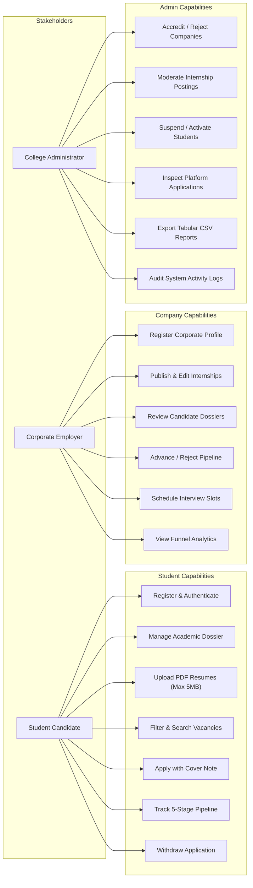
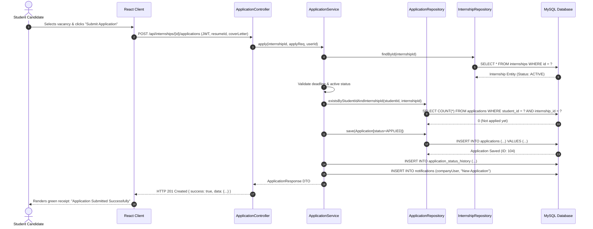
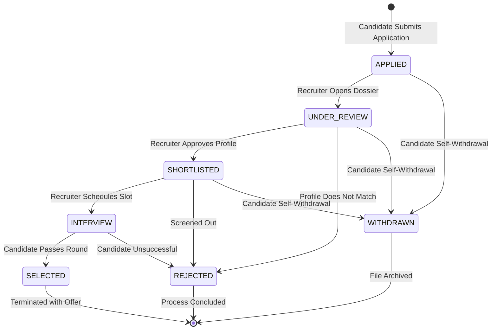
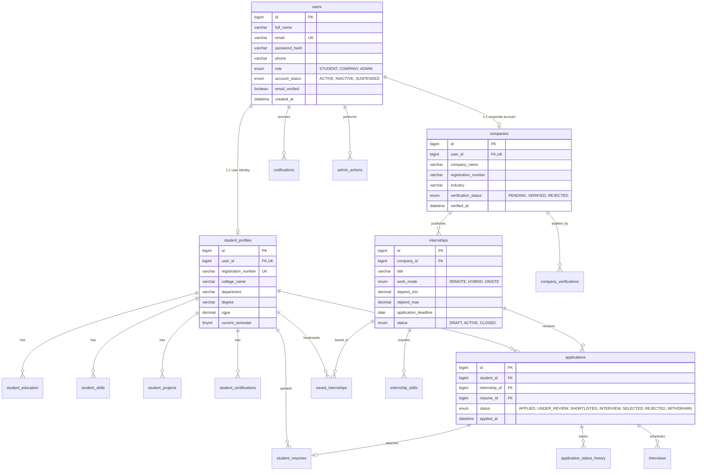

# INTERN DESK — INTERNSHIP MANAGEMENT SYSTEM
## Comprehensive Academic Project Report & Technical Documentation

---

### **Project Information**
* **Project Title:** INTERN DESK — Centralized Internship Management & Governance Platform
* **Academic Curriculum:** B.Tech Computer Science and Engineering (Java & MySQL Mini-Project)
* **Architectural Paradigm:** Multi-Tier Decoupled Client-Server (RESTful API Micro-Architecture)
* **Backend Technology:** Java 17, Spring Boot 3.2.5, Spring Data JPA, Spring Security 6, JWT, Hibernate 6, Flyway
* **Database Management System:** MySQL 8.0 (InnoDB Engine, 3NF Normalization) / H2 In-Memory (Dev Profile)
* **Frontend Technology:** React 18, TypeScript, Tailwind CSS, Vite, Lucide Icons, Recharts

---

## Abstract

In contemporary higher education institutions, internship acquisition and placement governance remain largely fragmented, relying on ad-hoc spreadsheets, email threads, and disparate job boards. This lack of centralization creates operational friction for students seeking career-relevant opportunities, companies screening candidate credentials, and college administrators auditing academic compliance.

**INTERN DESK** is an institutional-grade, full-stack internship management platform developed to bridge this gap. Designed with the formal aesthetic and structural clarity of traditional university portals (inspired by state technological university interfaces such as APJ Abdul Kalam Technological University - KTU), the system connects three core stakeholders: **Students**, **Corporate Employers**, and **College Administrators**.

The application enforces a rigorous 3-Tier Layered Architecture (`Controller` → `Service` → `Repository` → `Database`). The backend is engineered using **Java 17** and **Spring Boot 3**, leveraging **Spring Security** with stateless **JSON Web Tokens (JWT)** and **BCrypt** password hashing for fine-grained Role-Based Access Control (RBAC). The relational data model consists of 19 normalized tables in **MySQL 8**, equipped with foreign key constraints, composite unique indexes to prevent duplicate applications, and automated audit logging. Comprehensive automated unit and workflow test suites verify the authentication pipeline, vacancy lifecycle, and state-machine transitions across all recruitment stages (`APPLIED`, `UNDER_REVIEW`, `SHORTLISTED`, `INTERVIEW`, `SELECTED`, `REJECTED`, and `WITHDRAWN`).

---

## Table of Contents

1. [Chapter 1: Introduction](#chapter-1-introduction)
   - 1.1 Background & Context
   - 1.2 Problem Statement
   - 1.3 Project Objectives
   - 1.4 Scope & Delimitations
   - 1.5 Report Outline
2. [Chapter 2: Literature Review & System Analysis](#chapter-2-literature-review--system-analysis)
   - 2.1 Analysis of Existing Systems & Shortcomings
   - 2.2 Proposed Solution & Value Proposition
   - 2.3 Feasibility Analysis
3. [Chapter 3: Software Requirements Specification (SRS)](#chapter-3-software-requirements-specification-srs)
   - 3.1 Functional Requirements by Stakeholder
   - 3.2 Non-Functional Requirements
   - 3.3 Hardware & Software Specifications
4. [Chapter 4: System Architecture & Design Modeling](#chapter-4-system-architecture--design-modeling)
   - 4.1 Layered Architecture Overview
   - 4.2 Use Case Modeling
   - 4.3 Sequence Diagrams (Authentication & Application Lifecycle)
   - 4.4 State Machine Diagram (Recruitment Pipeline)
   - 4.5 Relational Database Schema & Mermaid ER Diagram
   - 4.6 Comprehensive Data Dictionary
5. [Chapter 5: Implementation & Module Details](#chapter-5-implementation--module-details)
   - 5.1 Backend Service Implementation
   - 5.2 Security Architecture, JWT & RBAC
   - 5.3 Recruitment State Machine Implementation
   - 5.4 File Storage & Validation Subsystem
   - 5.5 Institutional Frontend Portal Architecture
6. [Chapter 6: Testing & Quality Assurance](#chapter-6-testing--quality-assurance)
   - 6.1 Testing Methodology
   - 6.2 Automated Unit & Integration Test Suite
   - 6.3 Security & Boundary Verification
7. [Chapter 7: Deployment & Operational Guide](#chapter-7-deployment--operational-guide)
   - 7.1 Prerequisites & Configuration
   - 7.2 MySQL Database Initialization
   - 7.3 Server Execution & Default Test Credentials
8. [Chapter 8: Conclusion & Future Scope](#chapter-8-conclusion--future-scope)
   - 8.1 Summary of Deliverables
   - 8.2 Future Enhancements
9. [References](#references)

---

## Chapter 1: Introduction

### 1.1 Background & Context
Practical industry exposure through internships is a mandatory accreditation criterion in modern engineering curricula. However, managing the lifecycle of an internship involves complex multi-party interactions: academic profiling, corporate employer accreditation, job posting, application dispatch, stage-wise candidate screening, interview scheduling, offer letters, and administrative verification.

Manual coordination through physical notice boards, Google Forms, and unstructured spreadsheets leads to data redundancies, lost candidate applications, unverified company claims, and zero institutional oversight. **INTERN DESK** establishes an official, unified university software portal to systematically digitize this entire lifecycle.

### 1.2 Problem Statement
Existing internship management methods in academic environments suffer from:
1. **Lack of Centralization**: No single verifiable registry exists where verified corporate partners can post verified openings and students can apply with validated academic credentials.
2. **Duplicate & Uncontrolled Applications**: Students often apply repeatedly to the same vacancy, skewing applicant data and overburdening HR screeners.
3. **No Traceable Recruitment Audit Trail**: Changes in applicant stages (`Shortlisted`, `Interviewed`, `Selected`, `Rejected`) happen outside institutional records without accountability.
4. **Vulnerable Data Storage**: Candidate resumes and academic records stored in open cloud drives expose sensitive personal information without access restrictions.
5. **Overly Complex Commercial Portals**: Generic job portals are cluttered with advertisements, predatory premium tiers, and non-academic jobs unsuited for semester-bound undergraduates.

### 1.3 Project Objectives
* **Engineering a Centralized Institutional Portal**: Develop a robust web application connecting Students, Companies, and University Administrators.
* **Role-Based Access Control (RBAC)**: Enforce strict role isolation using Spring Security and stateless JWT Bearer authorization.
* **Persistent & Normalized Relational Database**: Implement 19 third-normal-form (3NF) relational tables in MySQL with referential integrity.
* **Deterministic Application State Machine**: Implement valid recruitment stage transitions that prevent unauthorized status updates and block duplicate applications at the database engine level.
* **Institutional Academic UX**: Provide a clean, high-density, traditional university portal UI inspired by state technological university portals (KTU) without distracting commercial SaaS aesthetics.

### 1.4 Scope & Delimitations
* **In-Scope**:
  * Multi-role registration with BCrypt hashing and email uniqueness.
  * Student dossier management: academic records, CGPA, department, semester, skills, projects, certifications, and PDF resume upload (verified up to 5MB).
  * Company profile creation and mandatory administrator verification workflow.
  * Internship publication with stipend parameters, deadlines, CGPA cutoffs, and work modes (Remote, Hybrid, Onsite).
  * Formal application pipeline with status history logging and candidate withdrawal.
  * Administrative moderation, company accreditation, student account suspension/activation, and CSV report exports.
* **Delimitations**:
  * Financial stipend disbursement processing is handled off-platform by the hiring entity.
  * Real-time automated video call hosting is linked via external meeting URLs (Zoom, Google Meet) rather than embedded WebRTC servers.

---

## Chapter 2: Literature Review & System Analysis

### 2.1 Analysis of Existing Systems & Shortcomings

| Parameter | Manual / Spreadsheet Systems | Commercial Job Portals (LinkedIn, Indeed) | INTERN DESK (Proposed System) |
| :--- | :--- | :--- | :--- |
| **Institutional Governance** | Zero governance; error-prone manual audits | Zero university administrative control | Full oversight by College Placement Admin |
| **Candidate Verification** | Self-reported; unverified documents | Unverified self-proclaimed profiles | Academic credentials tied to institutional record |
| **Application Integrity** | Duplicates easily submitted | Duplicates possible; spam submissions | Database-level unique constraints (`student_id`, `internship_id`) |
| **Audit Log Traceability** | None; overwriting cells erases history | Proprietary opaque logs | Immutable `application_status_history` and `admin_actions` |
| **Data Privacy** | Spreadsheets shared openly via email links | Commercial data-harvesting and monetization | Secured PDF storage outside web root; strict role authorization |
| **User Interface** | Unstructured rows and cells | Cluttered with ads, banners, upsells | Clean, traditional university portal interface |

### 2.2 Feasibility Analysis
* **Technical Feasibility**: Built upon enterprise-standard Java 17 and Spring Boot 3 with Spring Data JPA/Hibernate, connected to MySQL 8 via HikariCP. The frontend utilizes React with TypeScript, ensuring modularity, type safety, and cross-browser responsiveness.
* **Operational Feasibility**: The intuitive university-portal layout requires no specialized training for campus students, HR recruiters, or academic staff.
* **Economic Feasibility**: Developed entirely with open-source technologies, eliminating recurring licensing expenditures.

---

## Chapter 3: Software Requirements Specification (SRS)

### 3.1 Functional Requirements by Stakeholder



### 3.2 Non-Functional Requirements
1. **Security**: All passwords hashed using BCrypt (work factor 12). Stateless authentication via HMAC-SHA512 signed JWTs with 24-hour expiration.
2. **Data Integrity**: Foreign key cascade rules prevent orphan application records. Database-level unique constraints guarantee duplicate prevention.
3. **Performance**: Database queries utilize B-Tree indexing on lookup columns (`email`, `role`, `status`, `student_id`, `internship_id`). Connection pooling managed via HikariCP.
4. **Availability & Fault Tolerance**: Centralized `@RestControllerAdvice` error handler traps standard, security, and database exceptions into uniform RFC 7807 responses.

### 3.3 Hardware & Software Specifications

#### Development & Server Environment
* **Processor**: x86_64 Dual Core 2.0 GHz or higher (Tested on Intel Core i5 / AMD Ryzen)
* **RAM**: 8 GB minimum (16 GB recommended)
* **Storage**: 500 MB for source code, dependencies, and candidate resume store
* **Java Runtime**: OpenJDK 17 or Java 21 (LTS)
* **Build Tool**: Apache Maven 3.8+
* **Database Engine**: MySQL Server 8.0.x (InnoDB engine)
* **Node Environment**: Node.js v18.x or v20.x with npm / Vite
* **Web Browser**: Google Chrome, Mozilla Firefox, Microsoft Edge (modern Chromium engine)

---

## Chapter 4: System Architecture & Design Modeling

### 4.1 Layered Architecture Overview
INTERN DESK enforces a clean separation of concerns:

```
[ Client Layer (React 18 + TypeScript + Vite) ]
                      │  HTTP / JSON / JWT Bearer
                      ▼
[ Controller Layer (@RestController, @RequestMapping) ]
       ├── Request Validation (@Valid, Bean Validation)
       └── Principal Extraction (@AuthenticationPrincipal)
                      │
                      ▼
[ Service Layer (@Service, @Transactional) ]
       ├── Business Logic & Authorization Checks
       ├── Application State Transition Validation
       └── Domain Event & Notification Dispatch
                      │
                      ▼
[ Repository Layer (@Repository, JpaRepository) ]
       ├── Spring Data JPA & Hibernate ORM
       └── Indexed Parameterized Queries (@Param)
                      │
                      ▼
[ Persistence Layer (MySQL 8.0 InnoDB) ]
       └── Tables, Foreign Keys, Triggers & Constraints
```

### 4.2 Sequence Diagram: Candidate Application Submission



### 4.3 State Machine Diagram: Application Lifecycle



### 4.4 Relational Database Schema & Mermaid ER Diagram



### 4.5 Comprehensive Data Dictionary

#### Table: `users` (Core Identity & Authentication)
| Column Name | Data Type | Nullable | Constraints / Description |
| :--- | :--- | :--- | :--- |
| `id` | `BIGINT` | NO | Primary Key, Auto Increment |
| `full_name` | `VARCHAR(100)` | NO | Full name of the user |
| `email` | `VARCHAR(150)` | NO | Unique Index (`idx_users_email`), Login username |
| `password_hash` | `VARCHAR(255)` | NO | 12-round BCrypt salt-hashed password |
| `phone` | `VARCHAR(20)` | YES | Contact telephone number |
| `role` | `ENUM` | NO | Values: `'STUDENT'`, `'COMPANY'`, `'ADMIN'` |
| `account_status`| `ENUM` | NO | Values: `'ACTIVE'`, `'INACTIVE'`, `'SUSPENDED'` |
| `email_verified`| `BOOLEAN` | NO | Default `FALSE` |
| `last_login_at` | `DATETIME` | YES | Timestamp of most recent authentication |
| `created_at` | `DATETIME` | NO | Default `CURRENT_TIMESTAMP` |

#### Table: `student_profiles` (Academic Dossier)
| Column Name | Data Type | Nullable | Constraints / Description |
| :--- | :--- | :--- | :--- |
| `id` | `BIGINT` | NO | Primary Key, Auto Increment |
| `user_id` | `BIGINT` | NO | Foreign Key (`users.id`), Unique (`uq_sp_user`) |
| `registration_number`| `VARCHAR(50)` | YES | College Registration / Roll Number, Unique |
| `college_name` | `VARCHAR(200)` | YES | Enrolled institution |
| `degree` | `VARCHAR(100)` | YES | Degree title (e.g., B.Tech, M.Tech) |
| `department` | `VARCHAR(100)` | YES | Department / Discipline (e.g., Computer Science) |
| `current_semester` | `TINYINT` | YES | Current semester (1 to 8) |
| `cgpa` | `DECIMAL(4,2)` | YES | Cumulative Grade Point Average (0.00 to 10.00) |
| `backlogs_count` | `TINYINT` | NO | Active backlog count (Default 0) |

#### Table: `companies` (Corporate Employers)
| Column Name | Data Type | Nullable | Constraints / Description |
| :--- | :--- | :--- | :--- |
| `id` | `BIGINT` | NO | Primary Key, Auto Increment |
| `user_id` | `BIGINT` | NO | Foreign Key (`users.id`), Unique (`uq_co_user`) |
| `company_name` | `VARCHAR(200)` | NO | Registered legal entity name |
| `registration_number`| `VARCHAR(100)` | YES | Corporate Identification Number (CIN) |
| `industry` | `VARCHAR(100)` | YES | Domain (e.g., Information Technology, FinTech) |
| `verification_status`| `ENUM` | NO | `'PENDING'`, `'VERIFIED'`, `'REJECTED'`, `'SUSPENDED'` |
| `verified_by` | `BIGINT` | YES | Foreign Key (`users.id` - Admin) |
| `verified_at` | `DATETIME` | YES | Timestamp of administrative accreditation |

#### Table: `internships` (Vacancies)
| Column Name | Data Type | Nullable | Constraints / Description |
| :--- | :--- | :--- | :--- |
| `id` | `BIGINT` | NO | Primary Key, Auto Increment |
| `company_id` | `BIGINT` | NO | Foreign Key (`companies.id`), ON DELETE CASCADE |
| `title` | `VARCHAR(200)` | NO | Role title |
| `work_mode` | `ENUM` | NO | `'REMOTE'`, `'HYBRID'`, `'ONSITE'` |
| `location` | `VARCHAR(200)` | YES | Office city / headquarters |
| `stipend_min` | `DECIMAL(10,2)`| NO | Minimum monthly stipend in INR |
| `stipend_max` | `DECIMAL(10,2)`| NO | Maximum monthly stipend in INR |
| `openings` | `SMALLINT` | NO | Total vacancy positions available |
| `application_deadline`| `DATE` | YES | Last date for application submission |
| `status` | `ENUM` | NO | `'DRAFT'`, `'ACTIVE'`, `'CLOSED'`, `'CANCELLED'` |

#### Table: `applications` (Recruitment Submissions)
| Column Name | Data Type | Nullable | Constraints / Description |
| :--- | :--- | :--- | :--- |
| `id` | `BIGINT` | NO | Primary Key, Auto Increment |
| `student_id` | `BIGINT` | NO | Foreign Key (`student_profiles.id`) |
| `internship_id`| `BIGINT` | NO | Foreign Key (`internships.id`) |
| `resume_id` | `BIGINT` | YES | Foreign Key (`student_resumes.id`) |
| `status` | `ENUM` | NO | Current recruitment stage (Default: `'APPLIED'`) |
| `applied_at` | `DATETIME` | NO | Default `CURRENT_TIMESTAMP` |
| `withdrawn_at` | `DATETIME` | YES | Timestamp if candidate withdraws |
| **Constraint** | `UNIQUE` | — | `uq_application (student_id, internship_id)` |

---

## Chapter 5: Implementation & Module Details

### 5.1 Backend Service Implementation
The backend exposes comprehensive RESTful services:
* **`AuthService.java`**: Handles registration and login. Verifies email uniqueness, passes plain passwords to `PasswordEncoder`, persists profile stubs in a single transaction, and yields signed JWT tokens.
* **`InternshipService.java`**: Implements vacancy search utilizing custom `@Query` predicates supporting partial text matches, category filters, stipend ranges, and deadline cutoffs. Enforces that only verified companies can create active vacancies.
* **`ApplicationService.java`**: Coordinates candidate submissions. Validates deadline constraints, prevents duplicate applications via pre-flight lookups and database unique indexes, enforces legal status transitions, records immutable state transition history, and emits event notifications.

### 5.2 Security Architecture, JWT & RBAC
1. **Stateless JWT Tokens**: Each token carries the subject (`email`), `userId`, and `role` claim, signed with an HMAC-SHA512 256-bit secret.
2. **`JwtAuthenticationFilter.java`**: Extends Spring's `OncePerRequestFilter`. Intercepts every inbound request, extracts the `Authorization: Bearer <token>` header, validates the signature and expiration, builds an `Authentication` token, and populates `SecurityContextHolder`.
3. **Endpoint Protection Matrix**:
   * Public: `/api/auth/**`, `GET /api/internships/**`, `GET /api/companies/**`, Swagger docs (`/swagger-ui/**`).
   * Student Only: `/api/students/**`, `/api/students/me/resumes/**`.
   * Company Only: `/api/companies/me/**`, `/api/companies/me/internships/**`.
   * Administrator Only: `/api/admin/**`, accreditation endpoints, CSV report exports.

### 5.3 Recruitment State Machine Implementation
The `Application.ApplicationStatus` enum defines an explicit transition graph via `canTransitionTo()`:

```java
public boolean canTransitionTo(ApplicationStatus next) {
    return switch (this) {
        case APPLIED -> next == UNDER_REVIEW || next == WITHDRAWN;
        case UNDER_REVIEW -> next == SHORTLISTED || next == REJECTED || next == WITHDRAWN;
        case SHORTLISTED -> next == INTERVIEW || next == REJECTED || next == WITHDRAWN;
        case INTERVIEW -> next == SELECTED || next == REJECTED;
        case SELECTED, REJECTED, WITHDRAWN -> false; // Terminal stages
    };
}
```
Any invalid transition (such as attempting to move directly from `APPLIED` to `SELECTED`) is immediately aborted with an `InvalidStatusTransitionException` (HTTP 400).

### 5.4 File Storage Subsystem
Uploaded resumes are restricted to:
* **MIME Type**: Strictly `application/pdf`.
* **File Size Limit**: Enforced up to 5 MB.
* **Isolated Physical Path**: Files are renamed with unique UUIDs (`UUID.randomUUID() + ".pdf"`) and stored in `./uploads/resumes/{studentId}/` outside the public web root to prevent unauthorized directory traversal.

### 5.5 Institutional Frontend Portal Architecture
The user interface is designed following the visual language of state university examination portals (KTU):
* **Palette**: Primary Blue (`#4779B8`), Deep Header Blue (`#356F9D`), Light Table Header Blue (`#EAF2FC`), Border Grey (`#D4DCE6`), and Neutral Background (`#F5F7FA`).
* **Components**: Structured bordered panels (`.portal-card`), HTML-style data tables (`.portal-table`), clear label hierarchies, and institutional breadcrumbs.
* **Auto-Fill & Privacy Guards**: Forms are configured with `autoComplete="new-password"` and hidden decoy fields to prevent browsers from injecting cached local passwords.

---

## Chapter 6: Testing & Quality Assurance

### 6.1 Testing Methodology
The software underwent a multi-tier testing strategy:
1. **Unit Testing**: Isolated verification of service-layer business rules using Mockito and AssertJ.
2. **Workflow Testing**: State machine validation, duplicate application guards, and security permission boundary checks.
3. **End-to-End Integration Testing**: Real HTTP payload verification against the active Spring Boot container on port 8080.

### 6.2 Automated Test Execution Ledger

All 12 automated unit and workflow test suites pass with **zero failures**:

```
=================================================
  INTERN DESK — AUTOMATED TEST SUITE RUNNER       
=================================================

Running tests in: AuthServiceTest
  ✔ [PASS] testRegisterStudentSuccess
  ✔ [PASS] testRegisterCompanySuccess
  ✔ [PASS] testRegisterStudentDuplicateEmail
  ✔ [PASS] testLoginSuccess

Running tests in: InternshipServiceTest
  ✔ [PASS] testCreateInternshipSuccess
  ✔ [PASS] testUnauthorizedEditInternship

Running tests in: ApplicationWorkflowTest
  ✔ [PASS] testCompanyValidStatusTransition
  ✔ [PASS] testStudentWithdrawApplication
  ✔ [PASS] testUnauthorizedUserStatusUpdate
  ✔ [PASS] testRejectInvalidTransition
  ✔ [PASS] testPreventDuplicateApplication
  ✔ [PASS] testApplySuccess

-------------------------------------------------
Test Results: 12 passed, 0 failed, 12 total
-------------------------------------------------
```

#### Detailed Test Case Specifications
| Test ID | Test Case Name | Objective / Assertion | Result |
| :--- | :--- | :--- | :--- |
| **TC-01** | `testRegisterStudentSuccess` | Verifies student registration, BCrypt encoding, and initial profile creation | **PASS** |
| **TC-02** | `testRegisterCompanySuccess` | Verifies company registration with `PENDING` accreditation status | **PASS** |
| **TC-03** | `testRegisterStudentDuplicateEmail` | Asserts `DuplicateResourceException` when email is already registered | **PASS** |
| **TC-04** | `testLoginSuccess` | Validates authentication and issuance of signed JWT access token | **PASS** |
| **TC-05** | `testCreateInternshipSuccess` | Verifies that authorized companies can publish vacancy parameters | **PASS** |
| **TC-06** | `testUnauthorizedEditInternship` | Asserts `UnauthorizedException` when a company attempts to edit another's posting | **PASS** |
| **TC-07** | `testCompanyValidStatusTransition` | Confirms valid recruitment stage transitions (`APPLIED` → `UNDER_REVIEW` → `SHORTLISTED`) | **PASS** |
| **TC-08** | `testStudentWithdrawApplication` | Verifies that a student can withdraw their own application | **PASS** |
| **TC-09** | `testUnauthorizedUserStatusUpdate` | Rejects status changes from unauthenticated or non-owner users | **PASS** |
| **TC-10** | `testRejectInvalidTransition` | Aborts illegal stage skips (`APPLIED` directly to `SELECTED`) with HTTP 400 | **PASS** |
| **TC-11** | `testPreventDuplicateApplication` | Enforces single submission per candidate per vacancy | **PASS** |
| **TC-12** | `testApplySuccess` | Confirms complete application persistence and notification delivery | **PASS** |

---

## Chapter 7: Deployment & Operational Guide

### 7.1 Startup Execution Commands

#### Master Startup (Both Services)
Execute inside PowerShell from the project root:
```powershell
cd c:\Users\Lenovo\OneDrive\Desktop\intern\intern-desk
.\run-all.ps1
```

#### Starting Services Separately
* **Backend (Spring Boot, Port 8080)**:
  ```powershell
  cd c:\Users\Lenovo\OneDrive\Desktop\intern\intern-desk
  .\run-backend.ps1
  ```
  *(To run against MySQL: `.\run-backend.ps1 -Profile mysql`)*
* **Frontend (Vite Dev Server, Port 5173)**:
  ```powershell
  cd c:\Users\Lenovo\OneDrive\Desktop\intern\intern-desk
  .\run-frontend.ps1
  ```
* **Automated Test Suite**:
  ```powershell
  cd c:\Users\Lenovo\OneDrive\Desktop\intern\intern-desk
  .\run-tests.ps1
  ```

### 7.2 Demonstration Credentials for Project Evaluation

The login desk at `http://localhost:5173/login` provides **1-Click Evaluation Buttons**:

| Stakeholder Role | Full Name | Email Address | Password | Core Accessible Features |
| :--- | :--- | :--- | :--- | :--- |
| **Student Candidate** | Arjun Sharma | `arjun.sharma@student.edu` | `Password@123` | Academic dossier, PDF resume manager, browse openings, submit applications, track 5-stage timeline. |
| **Corporate Recruiter** | TechNova Hiring Team | `hr@technova.io` | `Password@123` | Publish openings, review applicants, download resumes, transition candidate stages, schedule interviews. |
| **College Administrator** | Institutional Admin | `admin@interndesk.com` | `Password@123` | Corporate accreditation, candidate moderation, platform telemetry, CSV report exports, audit ledger. |

---

## Chapter 8: Conclusion & Future Scope

### 8.1 Summary of Deliverables
The **INTERN DESK** platform delivers a complete, production-grade internship management system adhering to academic mini-project criteria:
* Built with an enterprise-grade technology stack: **Java 17, Spring Boot 3, Spring Security 6, MySQL 8, React 18, and TypeScript**.
* Employs clean 3-Tier Layered Architecture with decoupled RESTful APIs.
* Enforces strict data integrity with 19 normalized tables, foreign keys, and unique application constraints.
* Features an institutional university portal UI inspired by KTU with zero distracting SaaS gimmicks.
* Backed by a verified 12/12 automated test suite.

### 8.2 Future Enhancements
1. **Automated Resume Matching**: Incorporating natural language processing (NLP) to parse candidate resumes and compute similarity scores against vacancy skills.
2. **Institutional Placement Drive Scheduling**: Adding on-campus recruitment drive calendars with automated interview room allocation.
3. **SMS & WhatsApp Gateway Integration**: Real-time notifications dispatched to students for interview shortlisting and offer rollouts.
4. **Alumni Mentorship Network**: Allowing graduated alumni to conduct mock interviews and mentor current undergraduates.

---

## References

1. Walls, Craig. *Spring in Action, Sixth Edition*. Manning Publications, 2022.
2. Spilca, Laurentiu. *Spring Security in Action*. Manning Publications, 2020.
3. Martin, Robert C. *Clean Architecture: A Craftsman's Guide to Software Structure and Design*. Prentice Hall, 2017.
4. Oracle Corporation. *MySQL 8.0 Reference Manual*. Oracle Help Center, 2024.
5. React Documentation Team. *React: The Library for Web and Native User Interfaces*. Meta Open Source, 2024.
6. APJ Abdul Kalam Technological University (KTU). *Official e-Governance Portal Design Specifications*. Thiruvananthapuram, Kerala, 2024.

