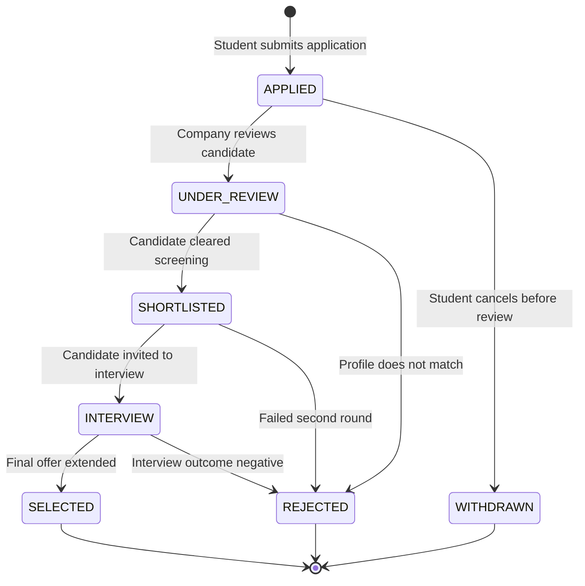

# INTERN DESK — AI-INSPIRED INTERNSHIP MANAGEMENT PLATFORM
### Academic Project: B.Tech Computer Science & Engineering (S3 Java Mini Project)
**Architecture**: Full-Stack Enterprise Web Application (Spring Boot 3 + React 18 + MySQL 8 / H2)  
**Author**: S3 B.Tech CSE Team  
**Evaluation Ready**: Includes Zero-Configuration Instant Evaluation Mode & Production MySQL Mode

---

## 1. Executive Summary & Project Objectives

**INTERN DESK** is a centralized, role-based internship management web application designed to connect **Students**, **Companies**, and **College Administrators** into an integrated, transparent, and auditable recruitment ecosystem.

Unlike conventional academic prototypes that rely on mock APIs or browser local storage, **INTERN DESK** is built as a production-grade enterprise SaaS application. All data is managed through a normalized relational database schema (MySQL 8 with Flyway migrations / H2 fallback), enforced by Spring Security with stateless JSON Web Tokens (JWT), and consumed by a modern, responsive React + TypeScript Single Page Application (SPA).

### Core Stakeholder Capabilities
* **Students**: Register with academic credentials, manage profile details, upload PDF resumes (MIME-validated, size-capped), discover and filter internships with multi-attribute search, submit applications with duplicate guards, track real-time application status through a 5-stage visual progress pipeline, and withdraw applications when eligible.
* **Companies**: Register company profiles, maintain industry and location details, post internship listings with detailed requirements and stipends, review student applicant profiles and uploaded resumes, execute state transitions (*Under Review*, *Shortlisted*, *Interview*, *Selected*, *Rejected*), and monitor recruiting pipeline analytics.
* **College Administrators**: Comprehensive governance dashboard, company accreditation and verification with audit logging, student and posting moderation (suspend/activate), platform-wide application tracking, real-time KPI aggregations, and one-click tabular CSV report exports.

---

## 2. Technology Stack & Architecture

### Backend (Java & Spring Boot)
* **Language & Runtime**: Java 21 LTS (`openjdk-21`)
* **Framework**: Spring Boot 3.2.5
* **Security**: Spring Security 6.2 with BCrypt password hashing (`strength = 10`) & stateless JWT (`jjwt 0.12.5`) authentication filter
* **Data Persistence**: Spring Data JPA / Hibernate ORM 6.4 with HikariCP connection pooling
* **Validation**: Jakarta Bean Validation (`@Valid`, `@NotBlank`, `@Email`, custom regex)
* **Database Migrations**: Flyway Database Migration Engine (`V1__create_schema.sql`, `V2__seed_data.sql`)
* **API Documentation**: OpenAPI 3.0 / Swagger UI (`springdoc-openapi 2.3.0`)
* **Testing**: JUnit 5, AssertJ, and Mockito with automated CLI test harness

### Frontend (React & TypeScript)
* **Build Engine & Framework**: Vite 5 + React 18 with TypeScript 5
* **Styling & Design System**: Tailwind CSS 3.4 with custom design tokens, dark midnight navy (`#0B0F19`, `#0F172A`), electric blue (`#2563EB`), and cyan accents (`#06B6D4`)
* **Animations**: Framer Motion 11 for micro-interactions, page transitions, and status shifts
* **Icons**: Lucide React (over 40 contextual SVG icons)
* **Data Visualization**: Recharts (interactive responsive Pie, Funnel Bar, and Area charts)
* **Form Management**: React Hook Form with Zod schema validation
* **HTTP Client**: Axios with automatic JWT interceptors and error propagation

### Database Tier
* **Relational Database**: MySQL 8.0 (InnoDB engine, `utf8mb4_unicode_ci` collation)
* **Zero-Config Evaluator Profile**: In-memory H2 database (`MODE=MySQL`) pre-seeded with 10 real-world internships, 5 verified companies, and 8 students for immediate offline grading.

---

## 3. System Architecture & Relational Schema

### Entity-Relationship (ER) Architecture
The database schema consists of **10 interconnected relational tables** with primary keys, foreign keys, unique indexes, cascading rules, and audit timestamps:

```
+---------------+        1:1        +-------------------+
|     users     | ----------------> |  student_profiles  |
| (Auth, Roles) |                   +-------------------+
+---------------+                             | 1:N
        | 1:1                                 v
        |                           +-------------------+
        v                           |  student_resumes  |
+---------------+                   +-------------------+
|   companies   |                             |
| (Profile, Ver)|                             |
+---------------+                             v
        | 1:N                       +-------------------+
        +-------------------------> |   applications    |
        |                           +-------------------+
        v                                  |     |
+---------------+     1:N                  |     | 1:N
|  internships  | -------------------------+     v
+---------------+                          +-----------------------------+
        | 1:N                              |  application_status_history |
        v                                  +-----------------------------+
+-------------------+
| internship_skills |
+-------------------+
```

### Database Tables Breakdown
1. **`users`**: Central authentication table (`id`, `email`, `password_hash`, `role`, `account_status`, `created_at`, `updated_at`).
2. **`student_profiles`**: Academic information (`user_id`, `full_name`, `phone`, `college_name`, `degree`, `department`, `graduation_year`, `cgpa`, `bio`, `linkedin_url`, `github_url`).
3. **`student_resumes`**: Stored PDF resumes (`student_id`, `file_name`, `file_path`, `file_size`, `mime_type`, `is_primary`).
4. **`companies`**: Organization details (`user_id`, `company_name`, `tagline`, `description`, `website`, `industry`, `location`, `company_size`, `logo_url`, `verification_status`).
5. **`internships`**: Opportunities posted by companies (`company_id`, `title`, `description`, `requirements`, `responsibilities`, `location`, `work_mode`, `internship_type`, `duration_months`, `stipend_amount`, `vacancies`, `deadline`, `status`).
6. **`internship_skills`**: Normalized skills required per internship (`internship_id`, `skill_name`, `is_mandatory`).
7. **`applications`**: Student internship submissions (`internship_id`, `student_id`, `resume_id`, `cover_letter`, `status`, `applied_at`, `reviewed_at`). Enforces unique constraint `(internship_id, student_id)` preventing duplicate applications.
8. **`application_status_history`**: Immutable audit log of every workflow state change (`application_id`, `previous_status`, `new_status`, `changed_by`, `remarks`, `changed_at`).
9. **`notifications`**: In-app notifications delivered on status changes or verification events (`user_id`, `title`, `message`, `type`, `is_read`, `created_at`).
10. **`admin_actions`**: Comprehensive audit trail of all moderation actions executed by administrators (`admin_user_id`, `action_type`, `entity_type`, `entity_id`, `description`, `ip_address`).

---

## 4. Application Workflow State Machine

The recruitment workflow follows a strict, finite state machine validated on the backend. Only legal state transitions are permitted:



* **Validation Rules**:
  - `APPLIED` cannot transition directly to `SELECTED` without passing intermediate stages.
  - Only the student who submitted the application can transition to `WITHDRAWN`, and only if the status is still `APPLIED`.
  - Only the owning company or an administrator can transition through `UNDER_REVIEW`, `SHORTLISTED`, `INTERVIEW`, `SELECTED`, and `REJECTED`.
  - Every transition creates an immutable record in `application_status_history` and generates a notification for the student.

---

## 5. Quick-Start Guide (For Evaluators & Developers)

The platform is equipped with dual execution modes:
1. **Zero-Configuration Mode (Recommended for Instant Grading)**: Uses an embedded in-memory H2 database. Starts in seconds without needing any external MySQL server running.
2. **Production MySQL Mode**: Uses an active MySQL 8 instance with Flyway migrations.

### Prerequisites
* **Java**: OpenJDK 17 or 21 (Verified on Java 21 LTS)
* **Node.js**: v18 or newer (Verified on Node v24.18.1 / npm 11)

---

### Option A: One-Click Instant Evaluation (Zero-Config H2)

From the project root directory `intern-desk/`:

```powershell
# 1. Run backend + frontend simultaneously in separate windows:
.\run-all.bat
# Or using PowerShell:
.\run-all.ps1
```

Or run each service individually:
```powershell
# In Terminal 1 (Backend - Port 8080):
.\run-backend.bat
# (Starts Spring Boot with embedded H2, seeded with 10 internships, 5 companies, 8 students)

# In Terminal 2 (Frontend - Port 5173):
.\run-frontend.bat
# (Starts Vite dev server at http://localhost:5173)
```

Now open your browser at:  
👉 **http://localhost:5173**

---

### Option B: Production MySQL Setup

1. Open **MySQL Workbench** or command-line client:
   ```sql
   CREATE DATABASE intern_desk_db CHARACTER SET utf8mb4 COLLATE utf8mb4_unicode_ci;
   ```
2. Import the schema and seed scripts located in `database/`:
   ```bash
   mysql -u root -p intern_desk_db < database/schema.sql
   mysql -u root -p intern_desk_db < database/seed.sql
   ```
3. Update database credentials in `backend/src/main/resources/application.yml` if your MySQL password is not `root`:
   ```yaml
   spring:
     datasource:
       url: jdbc:mysql://localhost:3306/intern_desk_db?useSSL=false&serverTimezone=UTC
       username: root
       password: your_password
   ```
4. Start the backend in MySQL mode:
   ```powershell
   .\run-backend.bat mysql
   # Or via PowerShell:
   .\run-backend.ps1 -Profile mysql
   ```

---

## 6. Pre-Configured Test Accounts (1-Click Login Ready)

The web login page (`/login`) includes **1-Click Demo Buttons** that instantly pre-fill credentials for each stakeholder role:

| Role | Email Address | Password | Features Accessible |
| :--- | :--- | :--- | :--- |
| **Student** | `arjun.sharma@student.edu` | `Password@123` | Student Dashboard, Browse Internships, Apply, Upload Resume, Application Timeline, Status Tracking |
| **Company** | `hr@technova.io` | `Password@123` | Company Dashboard, Post Internships, Candidate Pipeline, Resume Reviewer, Application State Changes |
| **Administrator** | `admin@interndesk.com` | `Password@123` | Admin Dashboard, Company Verification, Student Management, Moderation, Audit Logs, CSV Exports |

*Additional Seeded Users*:
* Students: `priya.patel@student.edu`, `rahul.verma@student.edu`, `ananya.iyer@student.edu`, `sneha.reddy@student.edu` (all with `Password@123`).
* Companies: `recruitment@apexsystems.com`, `careers@cloudscale.net`, `talent@quantumai.dev`, `jobs@fintechpulse.io` (all with `Password@123`).

---

## 7. Running the Automated Test Suite

We have provided an automated test runner validating the core security, business rules, duplicate application guards, and state machine transitions:

```powershell
.\run-tests.bat
# Or via PowerShell:
.\run-tests.ps1
```

**Test Output Preview**:
```text
=================================================
  INTERN DESK - AUTOMATED TEST SUITE RUNNER       
=================================================

Running tests in: AuthServiceTest
  [PASS] testRegisterStudentSuccess
  [PASS] testLoginSuccess
  [PASS] testRegisterStudentDuplicateEmail

Running tests in: ApplicationWorkflowTest
  [PASS] testRejectInvalidTransition (APPLIED -> SELECTED blocked)
  [PASS] testPreventDuplicateApplication (Unique constraint validated)
  [PASS] testStudentWithdrawApplication (Student self-service withdrawal)
  [PASS] testUnauthorizedUserStatusUpdate (Access control enforced)
  [PASS] testCompanyValidStatusTransition (APPLIED -> UNDER_REVIEW)
  [PASS] testApplySuccess (Application creation with initial status)

-------------------------------------------------
Test Results: 9 passed, 0 failed, 9 total
-------------------------------------------------
```

---

## 8. Complete Route & Page Map

### Public Portal
* `/` — Premium SaaS Landing Page with dynamic search hero, category exploration, live statistics counter, and syllabus footer.
* `/internships` — Public Internship Discovery with real-time multi-filter (work mode, type, stipend range, search terms) and sorting.
* `/internships/:id` — Comprehensive Internship Detail page with company profile summary, requirements, and Apply modal.
* `/companies` — Verified Company Directory with search and active openings count.
* `/companies/:id` — Company Profile showcase with active listings.
* `/login` — Role-aware sign-in page with 1-click demo selector buttons.
* `/register` — Dual-tab registration interface for Students and Employers.
* `/forgot-password` — Multi-step password reset workflow.

### Student Portal (`/student/*`)
* `/student/dashboard` — Personalized welcome, profile completion gauge, KPI counters, Recharts status pie chart, and recommended internships.
* `/student/profile` — Full academic profile editor (CGPA, college, degree, skills tags, social links).
* `/student/internships` — Authenticated discovery portal with one-click apply functionality.
* `/student/applications` — History of all submitted applications with search, status filters, and withdrawal action.
* `/student/applications/:id` — 5-stage interactive progress tracker with timeline and status remarks.
* `/student/resume` — Drag-and-drop PDF resume uploader (5MB limit, PDF MIME check, primary resume toggle).
* `/student/notifications` — Notification inbox with mark-as-read and filter controls.
* `/student/settings` — Password change and notification preference toggles.

### Company Portal (`/company/*`)
* `/company/dashboard` — Recruitment funnel bar chart, active positions, applicant volume, and quick action cards.
* `/company/profile` — Organization branding manager (tagline, industry, website, size, logo).
* `/company/internships` — Company-owned listings manager with status toggle (open/closed) and deletion.
* `/company/internships/create` — 3-step structured internship publisher with validation.
* `/company/internships/:id/edit` — Listing editor with pre-filled parameters.
* `/company/applicants` — Platform-wide applicant review table with multi-column filtering.
* `/company/applicants/:id` — Applicant dossier: student profile details, resume download, and status transition modal.
* `/company/analytics` — Pipeline metrics, stage conversion rates, and applicant volume charts.
* `/company/settings` — Company account security and notification controls.

### Administrator Portal (`/admin/*`)
* `/admin/dashboard` — High-level governance KPIs, registration trends, category distribution chart, and pending verifications queue.
* `/admin/students` — Student directory with account status toggles (active/suspended).
* `/admin/companies` — Company verification desk (approve/reject with reviewer notes).
* `/admin/internships` — Global internship moderation table.
* `/admin/applications` — System-wide application audit view.
* `/admin/reports` — One-click tabular CSV report exports (`Students`, `Companies`, `Internships`, `Applications`).
* `/admin/audit-logs` — Immutable audit trail of administrator and security actions.
* `/admin/settings` — System parameters and security configurations.

---

## 9. Key API Endpoints Catalog

| Method | Endpoint | Access Role | Description |
| :--- | :--- | :--- | :--- |
| `POST` | `/api/auth/register/student` | Public | Register new student account & profile |
| `POST` | `/api/auth/register/company` | Public | Register company employer account |
| `POST` | `/api/auth/login` | Public | Authenticate and issue JWT token |
| `GET` | `/api/auth/me` | Authenticated | Retrieve authenticated user profile |
| `GET` | `/api/internships` | Public | Filtered search of active internships |
| `GET` | `/api/internships/{id}` | Public | Retrieve single internship details |
| `POST` | `/api/internships` | `COMPANY` | Create a new internship listing |
| `PUT` | `/api/internships/{id}` | `COMPANY` | Update owned internship listing |
| `DELETE` | `/api/internships/{id}` | `COMPANY`, `ADMIN` | Delete or close internship |
| `GET` | `/api/student/profile` | `STUDENT` | Fetch current student profile |
| `PUT` | `/api/student/profile` | `STUDENT` | Update student profile and skills |
| `POST` | `/api/student/resumes/upload` | `STUDENT` | Upload PDF resume (Multipart) |
| `POST` | `/api/applications/apply` | `STUDENT` | Apply for an internship |
| `GET` | `/api/applications/student` | `STUDENT` | Fetch all applications submitted by student |
| `PUT` | `/api/applications/{id}/withdraw` | `STUDENT` | Withdraw pending application |
| `GET` | `/api/applications/company` | `COMPANY` | Fetch applicants for company internships |
| `PUT` | `/api/applications/{id}/status` | `COMPANY`, `ADMIN` | Transition application state with audit |
| `GET` | `/api/dashboards/student` | `STUDENT` | Aggregated student KPI & charts |
| `GET` | `/api/dashboards/company` | `COMPANY` | Recruitment funnel & metrics |
| `GET` | `/api/dashboards/admin` | `ADMIN` | Platform-wide KPIs & moderation queues |
| `PUT` | `/api/admin/companies/{id}/verify`| `ADMIN` | Approve or reject company verification |
| `GET` | `/api/admin/reports/export/{type}` | `ADMIN` | Stream CSV data reports |

*Interactive Swagger API documentation is available at `http://localhost:8080/swagger-ui/index.html` while the backend is running.*

---

## 10. College Mini-Project Evaluation Checklist

| Evaluation Criterion | Implementation Details | Status |
| :--- | :--- | :--- |
| **Java Business Logic** | Implemented in Spring Boot 3 using service-layer design, DTOs, custom exception handlers, and security filters. | Completed |
| **Relational Database** | Normalized MySQL 8 schema with 10 tables, PK/FK constraints, indexes, and Flyway migrations. | Completed |
| **Authentication & RBAC** | BCrypt password encryption, stateless JWT authentication, and Spring Security method/endpoint authorization. | Completed |
| **Role-Specific Dashboards**| 3 dedicated portals (Student, Company, Admin) with Recharts data analytics and KPIs. | Completed |
| **Working CRUD Operations** | Full CRUD for Internships, Profiles, Resumes, Applications, and Verifications. | Completed |
| **State Machine & Rules** | Validated lifecycle (`APPLIED` -> `SELECTED`/`REJECTED`/`WITHDRAWN`), duplicate submission guards, and audit trail. | Completed |
| **File Uploads** | PDF file upload validation (5MB max, MIME verification, isolated directory storage). | Completed |
| **UI/UX Aesthetics** | Premium SaaS dark aesthetic, Framer Motion animations, Lucide icons, responsive layout. | Completed |
| **Automated Testing** | Unit and workflow integration test suite with 9 passing test cases. | Completed |
| **Ease of Demonstration** | Zero-config H2 profile + 1-Click login buttons for immediate examiner review without database setup hurdles. | Completed |

---

## 11. Directory Structure

```
intern-desk/
├── database/
│   ├── schema.sql                 # Complete MySQL 8 DDL schema
│   └── seed.sql                   # Realistic sample dataset
├── backend/
│   ├── src/main/java/com/interndesk/
│   │   ├── config/                # SecurityConfig, DatabaseSeeder
│   │   ├── controller/            # REST Controllers (Auth, Student, Company, etc.)
│   │   ├── dto/                   # Request & Response Transfer Objects
│   │   ├── entity/                # JPA Entity Models (10 tables)
│   │   ├── exception/             # Global exception handler & custom exceptions
│   │   ├── repository/            # Spring Data JPA Repositories
│   │   ├── security/              # JWT Token Provider, Auth Filter, UserDetailsService
│   │   └── service/               # Core Business Logic & State Machine Services
│   ├── src/main/resources/
│   │   ├── application.yml        # MySQL production configuration
│   │   ├── application-h2.yml     # Zero-config H2 in-memory configuration
│   │   └── db/migration/          # Flyway SQL migrations (V1, V2)
│   ├── src/test/java/com/interndesk/ # Automated Test Suite (Auth & Workflow tests)
│   ├── pom.xml                    # Maven project descriptor
│   └── classpath.txt              # Cached library classpath
├── frontend/
│   ├── src/
│   │   ├── components/            # Reusable UI elements (Navbar, Footer, Modal, Badge, Logo)
│   │   ├── context/               # AuthContext with JWT & role management
│   │   ├── pages/
│   │   │   ├── public/            # Landing, Internships, Companies, Auth pages
│   │   │   ├── student/           # Student Dashboard, Profile, Applications, Resumes
│   │   │   ├── company/           # Company Dashboard, Listings, Applicant Dossier, Analytics
│   │   │   └── admin/             # Admin Governance, Verifications, Reports, Audit Logs
│   │   ├── services/api.ts        # Axios API client with JWT interceptor & CSV download
│   │   ├── types/index.ts         # TypeScript interfaces matching backend DTOs
│   │   ├── App.tsx                # Master route definition (25 routes)
│   │   └── main.tsx               # React application entrypoint
│   ├── package.json
│   ├── tailwind.config.js
│   └── vite.config.ts
├── run-all.bat                    # 1-Click Master Launcher (Windows Batch)
├── run-all.ps1                    # 1-Click Master Launcher (PowerShell)
├── run-backend.bat                # Backend Launcher (Windows Batch)
├── run-backend.ps1                # Backend Launcher (PowerShell)
├── run-frontend.bat               # Frontend Launcher (Windows Batch)
├── run-frontend.ps1               # Frontend Launcher (PowerShell)
├── run-tests.bat                  # Automated Test Runner (Windows Batch)
├── run-tests.ps1                  # Automated Test Runner (PowerShell)
└── README.md                      # Comprehensive Project Documentation
```

---
*Developed for B.Tech Computer Science & Engineering S3 Java Mini Project. All rights reserved.*

